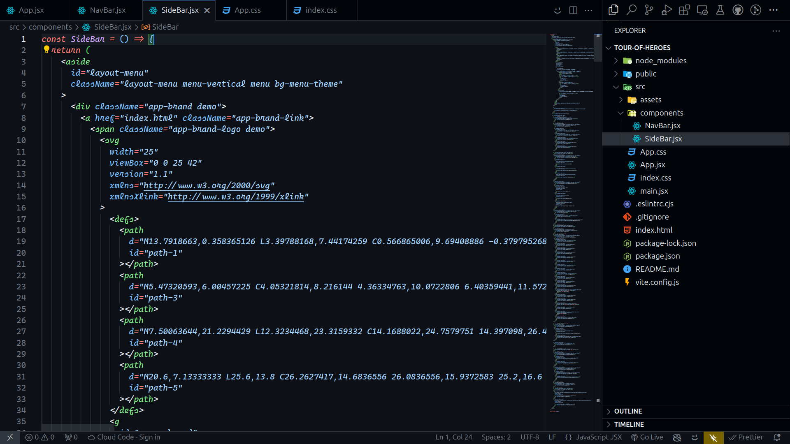

# TechSwahili Color Theme Extension

TechSwahili Color Theme is a vibrant and visually appealing color theme collection for Visual Studio Code that combines the beauty of Swahili culture with a developer-friendly coding environment. With these themes, you can bring a touch of East African flair to your coding experience.

## Available Themes

### 🌟 TechSwahili Modern Dark (NEW!)
A contemporary dark theme featuring:
- **Modern purple accent color** (#7c3aed) for a sophisticated look
- **Enhanced bracket pair colorization** with 6 distinct colors
- **Improved syntax highlighting** with better contrast and readability
- **Clean, minimal UI** with modern design elements
- **Better git integration** with clear status indicators
- **Optimized terminal colors** for improved readability
- **Contemporary color palette** inspired by modern design trends

### Other Available Themes
- **TechSwahili Deep**: Rich, deep dark theme with blue accents
- **Winter Is Back - TechSwahili Dark**: Classic dark theme with comprehensive language support
- **TechSwahili Dark - No Italics**: Same great theme without italic font styles
- **Winter Is Back - No Italics**: Classic version without italics
- **TechSwahili Light**: Clean light theme for daytime coding

## Features

- **Rich Color Palette**: The TechSwahili Color Theme collection offers carefully curated selections of colors inspired by the vibrant culture of East Africa. The harmonious blend of hues enhances readability and makes your code visually engaging.

- **Language Support**: All color themes have been designed to provide optimal syntax highlighting for a wide range of programming languages and file types. Whether you're writing code in JavaScript, Python, HTML, CSS, or any other language, TechSwahili Color Themes ensure a consistent and enjoyable coding experience.

- **Accessibility**: We believe in inclusivity and strive to make our themes accessible to all users. The TechSwahili Color Themes meet accessibility standards by maintaining suitable contrast ratios, making it easier for users with visual impairments to read and write code.

- **Modern UI Features**: The latest Modern Dark theme includes enhanced support for modern VS Code features like bracket pair colorization, improved git decorations, and contemporary status indicators.

## Installation

1. Launch Visual Studio Code.

2. Go to the Extensions view by clicking on the square icon in the left sidebar or by pressing `Ctrl+Shift+X`.

3. Search for "TechSwahili Theme" and click on the "Install" button for the extension published by Ramadhanmkoma.

4. Once installed, go to `File -> Preferences -> Color Theme` and select "TechSwahili Color Theme" from the dropdown menu.

## Feedback and Contributions

We welcome any feedback, suggestions, or bug reports related to the TechSwahili Color Theme Extension. Feel free to [open an issue](https://github.com/Ramadhanmkoma/VSCode-Color-Theme-Extension) on our GitHub repository.

If you would like to contribute to the development of this color theme, please follow our [contribution guidelines](CONTRIBUTING.md).

## License

The TechSwahili Color Theme Extension is released under the [MIT License](LICENSE.md). Feel free to use, modify, and distribute the theme according to the terms of the license.

---

Get ready to code in style with the TechSwahili Color Theme Extension! If you enjoy using our theme, don't forget to share it with your fellow developers.

Happy coding! 🚀
